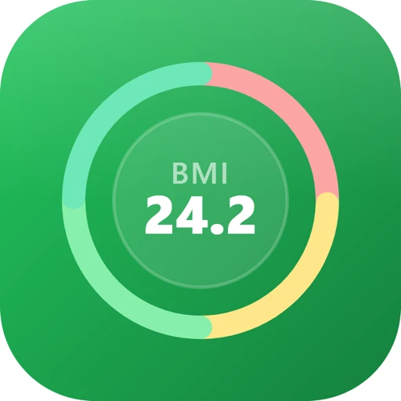
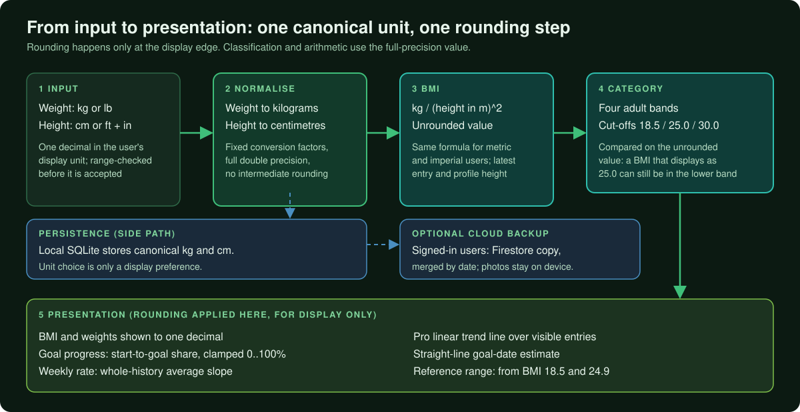
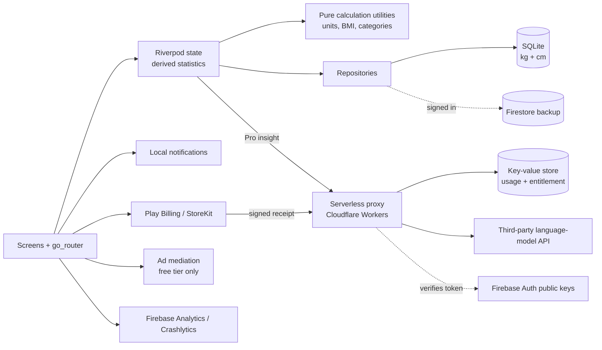

# Slim Track: Weight Loss & BMI

**A local-first weight and BMI tracker whose engineering centre of gravity is numerical correctness: one canonical unit system, unrounded intermediate values, and rounding applied when numbers are displayed.**

**Android · iOS** 
Flutter · Dart · Riverpod · SQLite · Firebase · Cloudflare Workers

<table>
  <tr>
    <td align="center"> <b>Dashboard</b> BMI card with a four-band scale and stat tiles</td>
    <td align="center"> <b>Empty state</b> One primary action before the first entry</td>
    <td align="center"> <b>Settings</b> Independent weight and height unit toggles, goal, reminder</td>
  </tr>
</table>
Real screenshots from the Android build, cropped to the app content (system status bar and bottom strip removed), captured with a placeholder profile and sample data, metadata removed.

---

## Get the App

  
  

## What This Is, and What It Is Not

Slim Track is a **weight-logging and BMI-tracking tool**. You record a weight, set an optional goal, and the app shows your BMI, progress and history. BMI is a general screening statistic, not a diagnosis. The app does not diagnose, treat or replace professional advice, and this repository describes software engineering, not health outcomes.

The app itself says so on its BMI detail screen (BMI is a screening tool and does not diagnose body fatness or health) and on its About BMI screen, which lists the metric's limitations and lists public health sources, with a note that the content is for general information only.

It does not calculate calories, BMR or TDEE, does not track activity or body measurements, does not integrate with HealthKit or Health Connect, does not use gender in any calculation, and makes no claim about a safe or recommended rate of change.

## Product at a Glance

| | |
|---|---|
| **What it is** | Daily weight log, BMI with four standard adult categories, goal progress, history, charts, daily reminder |
| **Units** | Weight in kg or lb, height in cm or ft/in, switchable independently; all values stored in kg and cm |
| **Pro tier** | Ad-free, longer chart ranges, linear trend line, photo journal with side-by-side compare, CSV and PDF export, a weekly generated text summary |
| **Data model** | Local-first SQLite; optional sign-in (Google, Apple) adds a Firestore backup; photos stay on the device |
| **Platforms** | Android and iOS from one Flutter codebase, with thin Kotlin and Swift native layers |
| **Backend** | One small serverless proxy on Cloudflare Workers: token verification, entitlement checks, usage limits, purchase-receipt verification |
| **Languages** | 20 selectable app languages |
| **Code size** | About 41,500 lines of Dart in 173 hand-written files (app source only, generated localisation code excluded) and about 1,250 lines of TypeScript in the proxy |

## Headline: Getting the Arithmetic Right

A BMI tracker is a few lines of arithmetic, which is exactly why mistakes survive: unit conversion drift, rounding applied too early, and threshold checks run on a number the user sees rounded. Slim Track is built around three rules.

1. **One canonical unit system.** Weight is stored in kilograms and height in centimetres. The kg/lb and cm/ft-in switches are display preferences; conversion happens only at the input and output edges.
2. **Unrounded values internally, rounding at the display edge.** Converted values are not rounded between normalisation and the BMI computation. Rounding to one decimal is applied when a number is rendered (typed input is itself taken to one decimal in the user's unit).
3. **Classify on the unrounded value.** Category cut-offs (18.5, 25.0 and 30.0, the commonly used adult BMI cut-offs) are compared against the full-precision BMI, not the displayed one.

  

**Worked example (generic numbers, not user data).** Height 170 cm.

| Entered | Normalised | Unrounded BMI | Displayed | Band |
|---|---|---|---|---|
| 70 kg | 70 kg, 1.70 m | 24.221 | 24.2 | second band (18.5 to below 25) |
| 154 lb, 5 ft 7 in | 69.853 kg, 170.18 cm | 24.120 | 24.1 | second band |
| 72.2 kg | 72.2 kg, 1.70 m | 24.983 | 25.0 | second band (just below the cut-off) |
| 72.3 kg | 72.3 kg, 1.70 m | 25.017 | 25.0 | third band (at or above 25.0) |

The last two rows show why the order of operations matters. Both display as 25.0, yet they sit in different bands because the comparison uses the unrounded value. Rounding the converted weight early has a visible cost too: 154 lb rounded to 69.9 kg and converted back reads 154.1 lb, so the stored kilogram value is kept at full precision. The full reasoning, including the limits of the approach, is in [docs/TECHNICAL_CASE_STUDY.md](docs/TECHNICAL_CASE_STUDY.md).

## Engineering Highlights

### Numbers that stay consistent across units
- **Problem:** two unit systems and several screens (dashboard, history, charts, goal, exports) can easily disagree by a rounding step.
- **Approach:** canonical kg and cm storage, a single conversion utility, one BMI formula for both unit systems (computed from stored kg and cm), input range checks in the user's display unit, and rounding only in formatting helpers.
- **Outcome:** the same stored value produces the same BMI and category wherever it appears, regardless of the display unit (unit toggling during onboarding is a known small exception, see the case study). Honest limit: there is no dedicated automated test suite for this math yet (see below).

### Local-first data with an optional cloud copy
- **Problem:** logging must be instant and work offline, with no forced account, yet users still want to recover data on a new phone.
- **Approach:** SQLite is the working store. Signed-in users get background Firestore writes with a timeout, a per-row synced flag acting as an offline queue, a flush on reconnect, and an initial merge at sign-in that keeps the newest write per date and replaces local rows in one transaction.
- **Outcome:** the app is fully usable as a guest, and sync failures never block the interface.

### A thin serverless edge instead of a key in the binary
- **Problem:** a weekly generated insight needs a paid third-party language-model API, and a provider key cannot safely live in a shipped mobile app.
- **Approach:** a small Cloudflare Workers proxy is the only caller of the provider. It verifies the user's Firebase identity token itself with Web Crypto, checks a time-boxed entitlement record, enforces per-user rate and weekly usage limits, and records usage only after a successful call. The app falls back to the last saved insight when a call fails.
- **Outcome:** no provider credential in the app, and paid-feature access decided server-side from store-signed evidence.

### Subscription receipts verified without a billing vendor
- **Problem:** a local "is Pro" flag cannot protect a paid backend feature.
- **Approach:** the app forwards the store's signed purchase data, and the proxy verifies the signatures offline against the platform vendors' trust anchors and writes a short-lived entitlement record.
- **Outcome:** backend access depends on cryptographic evidence rather than a client flag. Trade-offs are listed in the case study.

### More

| Area | What was built |
|---|---|
| **Reminders** | Android: a self-rescheduling WorkManager chain re-armed at every launch, no exact-alarm permission; iOS: repeating local notifications rescheduled on language change; permission asked after an in-app soft prompt |
| **Charts and trend** | Selectable ranges (some Pro), goal line, tap tooltips, optional linear trend line from a least-squares fit |
| **Ads** | Free tier only, remotely controlled, fail-closed until a real config read succeeds, with a startup gate that always resolves |
| **Analytics** | Typed events with counts, durations and buckets; no raw weight, name, height or goal; collection held off on iOS until the tracking prompt is answered |
| **Export** | CSV with a byte-order mark and a formatted PDF report with a locale-aware font strategy |
| **Account control** | Sign-out, local reset and in-app account deletion with Apple token revocation |

Problem, approach, trade-offs and outcome for each: [docs/ENGINEERING_CHALLENGES.md](docs/ENGINEERING_CHALLENGES.md).

## Architecture

Additional diagrams and sequences: [docs/ARCHITECTURE.md](docs/ARCHITECTURE.md).

## Technology Stack

| Layer | Technology |
|---|---|
| App framework | Flutter / Dart 3, Material UI, light/dark/system theme |
| State and navigation | Riverpod (state notifiers, streams, derived providers), go_router with a tabbed shell |
| Local persistence | SQLite (schema-versioned, transactional merges), shared preferences for flags |
| Cloud | Firebase Auth (Google, Apple), Cloud Firestore, Analytics, Crashlytics, Performance, Messaging |
| Charts and documents | fl_chart; PDF generation, CSV, share sheet |
| Billing | In-app purchase plugin over Google Play Billing and StoreKit |
| Ads | Ad-mediation SDK (free tier) |
| Notifications | Local notifications, timezone handling, WorkManager (Android) |
| Serverless | TypeScript on Cloudflare Workers with a key-value store; Web Crypto for token and receipt verification |
| Localisation | Flutter ARB-based localisation, 20 selectable languages |
| Tooling | flutter_lints, R8 shrinking in release builds |

## Testing, Honestly

The production project contains 18 test files with roughly 178 test declarations (a static count, not the result of a run). They cover the analytics subsystem, ad-lifecycle logging, connectivity tracking and related helpers. **BMI, unit conversion, goal and trend calculations, sync logic and the serverless proxy have no dedicated automated tests.** Those functions are pure and small, which makes them the natural next target. Details in [docs/TECHNICAL_CASE_STUDY.md](docs/TECHNICAL_CASE_STUDY.md).

## Project Scope

Slim Track is a production application on both stores. This portfolio focuses on the engineering represented in the app: numerical handling, local-first data, the serverless edge and platform integration.

## Documentation

| Read | For |
|---|---|
| [Technical case study](docs/TECHNICAL_CASE_STUDY.md) | End-to-end technical write-up, including the numerical-correctness deep dive |
| [Architecture](docs/ARCHITECTURE.md) | Diagrams, data flows and component responsibilities |
| [Engineering challenges](docs/ENGINEERING_CHALLENGES.md) | Problem, approach, trade-offs, outcome |
| [Product overview](docs/PRODUCT_OVERVIEW.md) | Features, screens and positioning |
| [Privacy and source](docs/PRIVACY_AND_SOURCE.md) | What is and is not published |

## Source Code

This repository is a portfolio showcase for a production application. Production source code is maintained privately. See [RIGHTS.md](RIGHTS.md) for usage terms.
