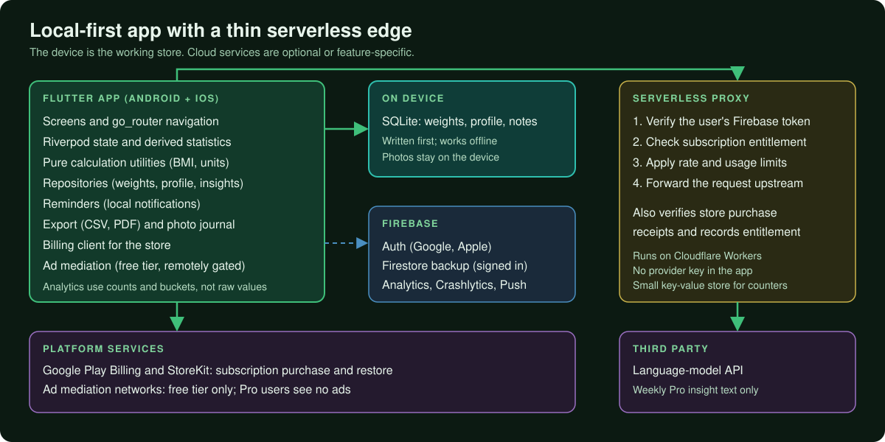
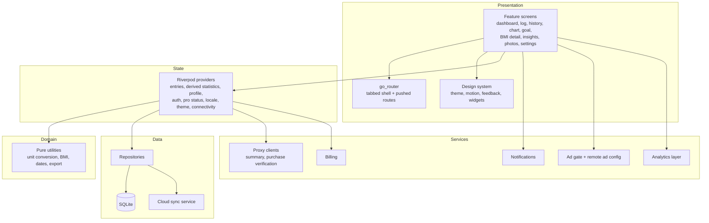
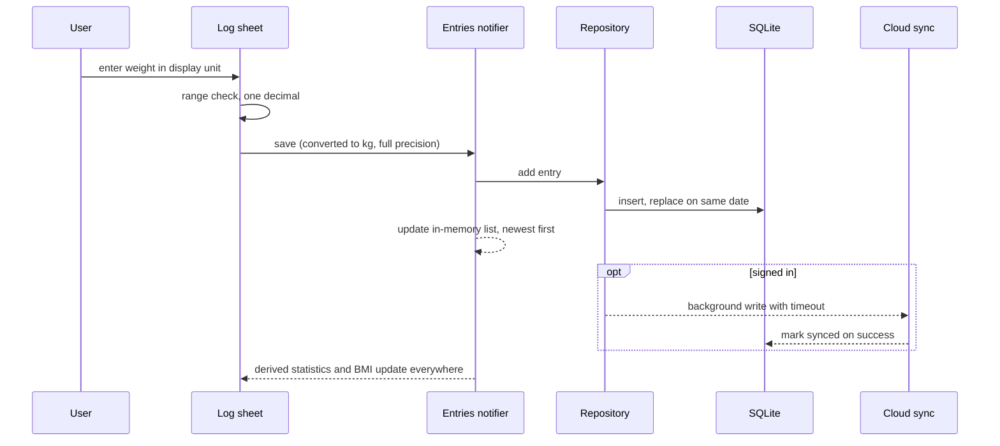
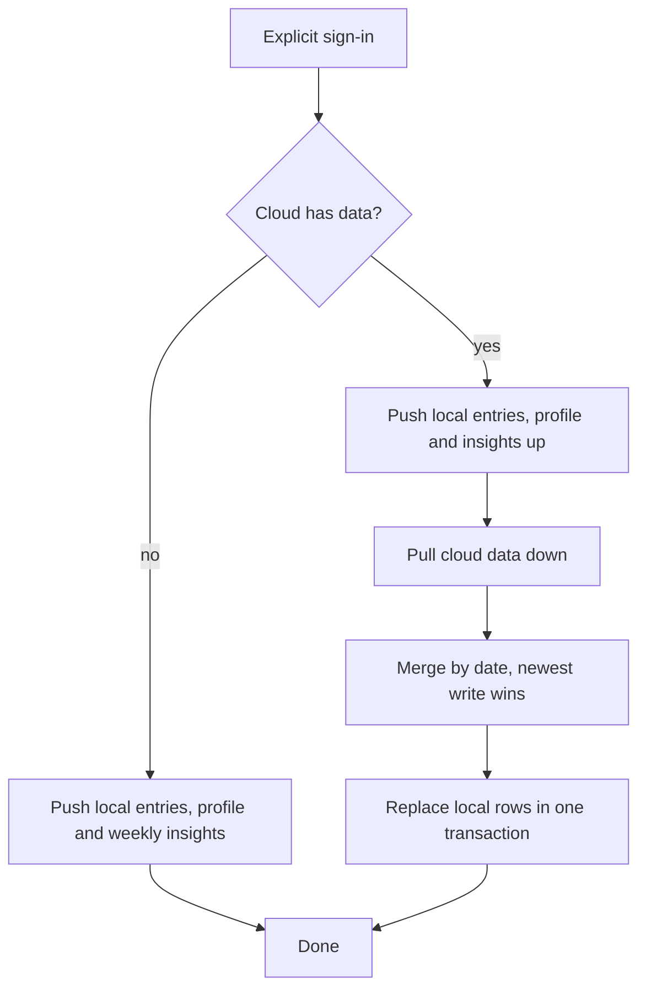
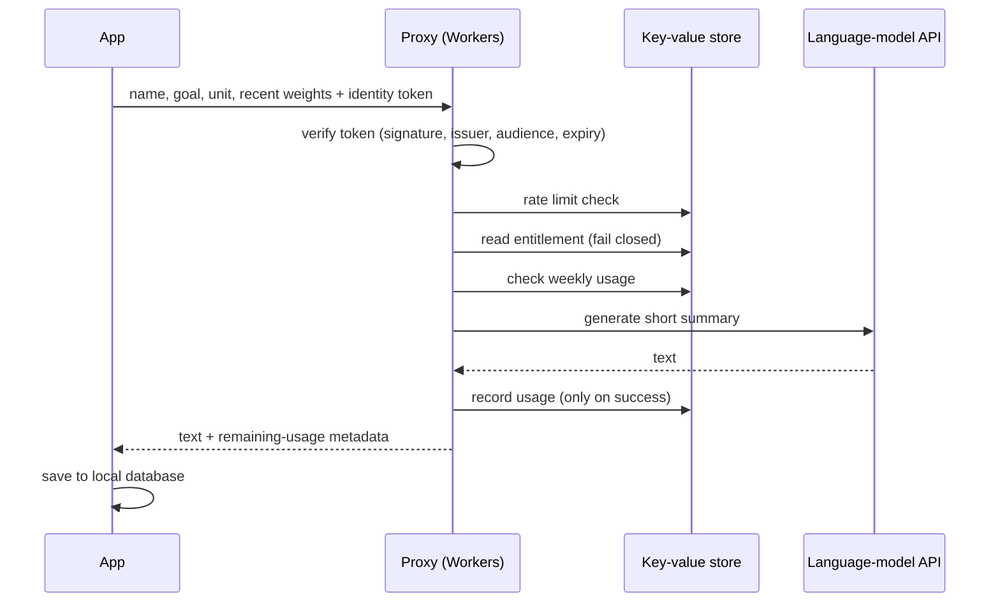
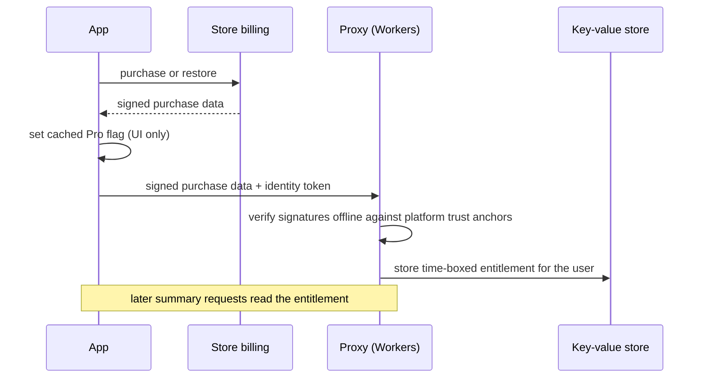

# Architecture

All diagrams below are original and conceptual. Component names describe responsibilities; they are not the names of production classes, files, collections or routes.

## 1. System overview

  

The device is the working store. Cloud services are either optional (backup for signed-in users) or feature-specific (the Pro weekly summary and purchase verification behind one small serverless proxy).

## 2. Layers inside the app

| Layer | Responsibility |
|---|---|
| **Presentation** | Feature-first screens, a tabbed shell with pushed detail routes, a shared design system (colours, motion tokens, staggered entrances, pressable feedback, tap sound and haptics, a guided tour) |
| **State** | Riverpod notifiers and streams hold entries, profile, auth and Pro state; derived providers compute statistics (start, current, lowest, highest, change, tracking span) so every screen reads the same numbers |
| **Domain utilities** | Stateless functions for unit conversion, BMI and category, reference range, date handling and export formatting. They hold no state and have no framework dependency beyond localisation labels |
| **Data** | Repositories wrap SQLite and, when signed in, the cloud sync service. SQLite is written first |
| **Services** | Clients for the serverless proxy, local notifications, the startup ad gate, the analytics layer and billing |

## 3. Calculation pipeline

See the diagram in the [technical case study](TECHNICAL_CASE_STUDY.md#2-numerical-correctness-the-headline). The key invariant is that stored values are kilograms and centimetres at full precision, and rounding is applied only by formatting helpers at render time.

## 4. Logging a weight

If the cloud write fails or times out, the row simply stays unsynced and is retried by a flush on reconnect.

## 5. Sign-in merge

The merge is intentionally tied to an explicit sign-in rather than cold start, because it replaces local rows.

## 6. Weekly summary request

## 7. Purchase verification

## 8. Startup

Startup initialises local services and Firebase, loads remote ad configuration with a fail-closed default, seeds the cached Pro flag before the first frame so Pro users never see upgrade prompts or ad slots, then runs a launch gate. On iOS the tracking prompt comes first and analytics collection is enabled only afterwards. Each phase is timed with a performance trace.

## 9. Responsibilities at a glance

| Concern | Where it lives | Why |
|---|---|---|
| Numbers shown to the user | Domain utilities plus derived providers | One source for every screen |
| Entitlement decisions for paid backend features | Serverless proxy | A client flag cannot protect a server resource |
| Provider credentials | Serverless proxy only | Nothing secret ships in the app |
| Offline correctness | SQLite first | Logging must never wait on the network |
| Ad on/off control | Remote configuration, fail closed | Misconfiguration or SDK failure must not block or surprise users |
| Analytics hygiene | Typed, bucketed event layer | Health-adjacent values do not leave the device through analytics |

## 10. Deliberate simplicity

The app uses repositories and a handful of singleton services beside Riverpod providers rather than a heavier layered framework. For a product of this size the benefit of fewer indirections outweighs the cost of a few cross-layer calls, and the pure calculation utilities remain trivially testable.
