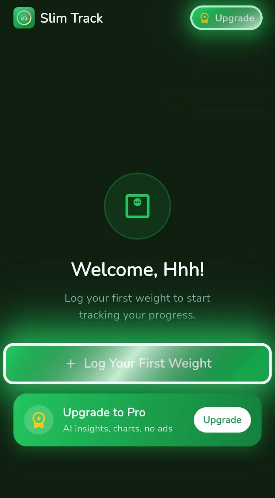
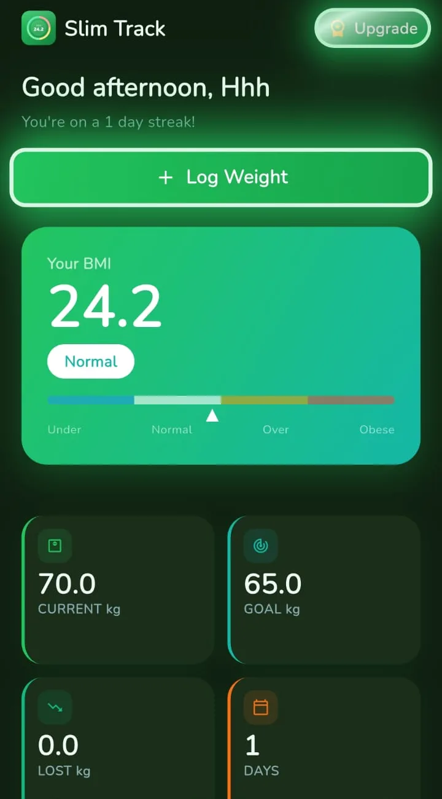
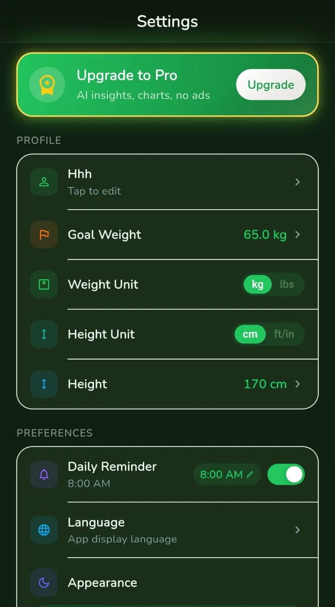

# Product Overview

All screenshots on this page are real captures from the Android build, cropped to the app content (system status bar and bottom strip removed), captured with a placeholder profile and sample data, with metadata removed.

## What it is

Slim Track is a weight-logging and BMI-tracking app for Android and iOS. A user records a body-weight value, optionally sets a goal weight, and the app derives BMI, progress, history and charts from those entries. It is a logger plus arithmetic. It is not a diet planner, and it is not a medical product.

## Positioning and safety stance

- BMI is presented as a general screening statistic. The BMI detail screen states that BMI is a screening tool and does not diagnose body fatness or health.
- An About BMI screen explains the formula, lists the four category ranges, spells out limitations (BMI does not distinguish muscle from fat, does not adjust for age, sex or ethnicity, needs different charts for children, and is not diagnostic), and lists public health sources, with a note that the content is for general information only and not medical advice.
- The app does not calculate calories, BMR or TDEE, does not track activity, food or body measurements, does not integrate with HealthKit or Health Connect, and does not use gender in any calculation.
- The app makes no claim about a safe or recommended rate of change. The goal screen shows an estimate derived from the user's own history, nothing more.

## Core loop

1. Onboard in a few steps: name, current weight, gender (collected and stored, not used in any calculation), height, goal weight, reminder time, optional sign-in.
2. Log a weight (one entry per calendar day) from the dashboard, with an optional note and, for Pro users, an optional photo.
3. Read the result: BMI and its band, change from the start weight, progress toward the goal.
4. Review history and charts; get a daily reminder to log again.

<table>
  <tr>
    <td align="center"> <b>Empty state</b> Before the first entry the dashboard offers a single primary action</td>
    <td align="center"> <b>Dashboard</b> BMI card with a four-band scale; tiles for current weight, goal, change and tracking span</td>
    <td align="center"> <b>Settings</b> Goal weight, independent weight and height unit toggles, daily reminder, language, appearance</td>
  </tr>
</table>

## Feature set

| Area | Behaviour |
|---|---|
| **Logging** | One entry per date; numeric entry with one decimal, a stepper, a date picker that rejects future dates, optional note; edit and delete with confirmation |
| **Units** | Weight in kg or lb, height in cm or ft/in; each is an independent display preference, values are stored in kg and cm |
| **BMI** | Computed from the latest entry and the profile height; four adult bands using the commonly used 18.5, 25.0 and 30.0 cut-offs |
| **Goal** | A single goal weight; progress share, weight changed so far, a weekly rate from the whole logged history, and a straight-line estimate of the date the goal would be reached at that rate (estimate only) |
| **Reference range** | The weight range that corresponds to BMI 18.5 to 24.9 at the user's height (computed from BMI 18.5 and 24.9 with the same formula) |
| **History** | Entry list with per-entry BMI, edit and delete |
| **Charts** | Line chart with a dashed goal line and tap tooltips; ranges from 7 days to all time, the longer ranges being Pro |
| **Trend line (Pro)** | A linear trend line fitted to the visible entries |
| **Reminders** | A daily reminder at a user-chosen time, localised to the app language |
| **Photo journal (Pro)** | Photos attached to entries, a grid view and a side-by-side comparison of any two dates; photos are not uploaded by the sync layer |
| **Export (Pro)** | CSV and a formatted PDF report |
| **Weekly summary (Pro)** | A generated text summary of recent logged weights, produced through a server-side proxy; shown only for signed-in Pro users with enough recent data. It is generated text, not professional advice |
| **Accounts** | Optional Google or Apple sign-in for cloud backup; guest mode keeps everything local; in-app reset and account deletion |
| **Personalisation** | 20 selectable languages, light/dark/system theme, sound and haptic toggles, a guided tour of the main screens |

## Free and Pro

The free tier shows ads through a mediation layer that can be switched off remotely. Pro is a subscription that removes ads and unlocks the longer chart ranges, the trend line, the photo journal, exports and the weekly summary. Store pricing and trial eligibility are resolved from the store at runtime and are not published here.

## Platforms

Android and iOS from one Flutter codebase. The UI is portrait-only. Native code is limited to a launch splash, a tracking-permission bridge on iOS and the integration points required by the SDKs.

## What the app does not do

No calorie, nutrition, activity, sleep or body-measurement tracking. No wearable or health-platform integration. No medical alerts and no guidance on pace in the logging, BMI and goal screens. The optional Pro weekly summary is generated text that can include a general suggestion; it is not professional advice. These are scope decisions of a deliberately small tool, and they are stated here so the portfolio does not imply otherwise.
